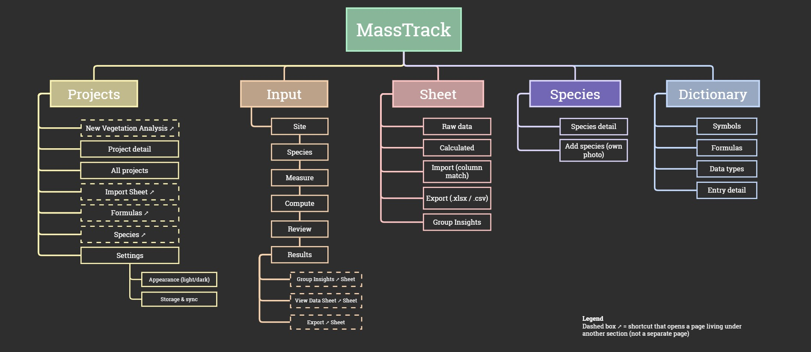
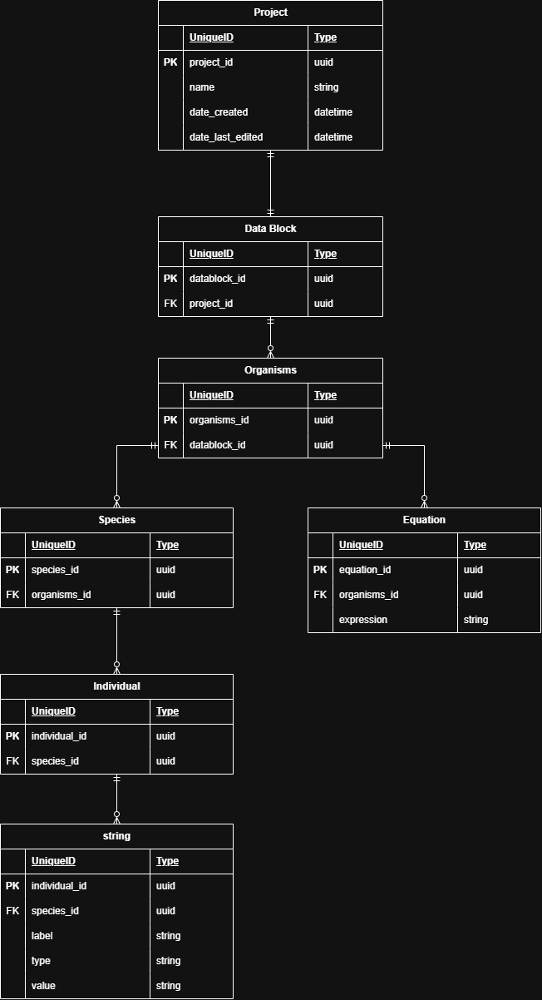

# Masstrack

This repository will be the main repo for the version control of MassTrack.  
This repository was previously used for Lab 0.

## Group Members

- John Benedict Aparicio    
- Ralph Ryan Escabarte
- Jasper Espartero
- John Matthew Fallarme
- Adrian Moser


# Links:
Kanban - https://trello.com/b/yQC0Jcqa/kanban-masstrack-cmsc134  
Figma - https://www.figma.com/design/8qMSawgLQJq92RFbOcDb9X/MassTrack-App-Wireframe?node-id=0-1&t=NgyijZztLb2xFwJc-1

## Site Map

## Data Model (ER)


---
# Dev Instructions
- Requires Node.js 22.13 or newer (check with `node -v`)
- Open terminal in vscode
```
    cd masstrack
    npm install
```
- Then you can begin developing!
### To run the app type in the terminal
```
    npx expo start
```

### To access the app's look
- Download Expo Go on google play store /app store

- Scan qr code generated by npx expo start in the terminal
